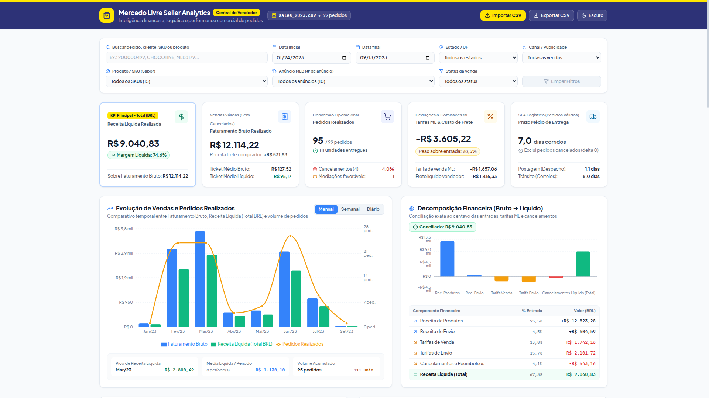
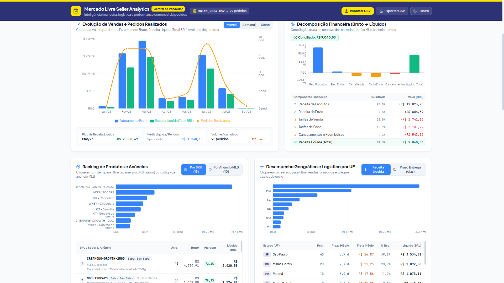
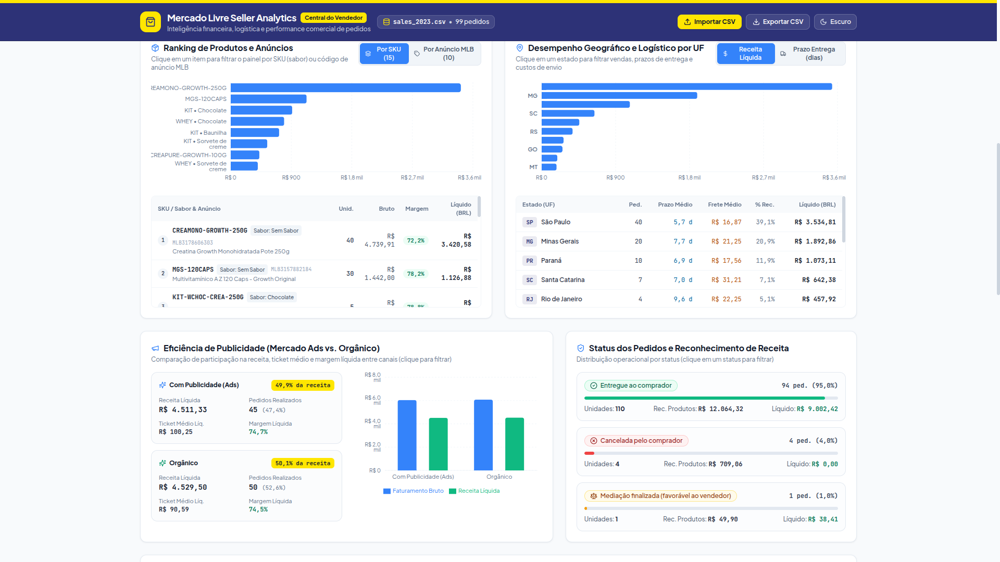
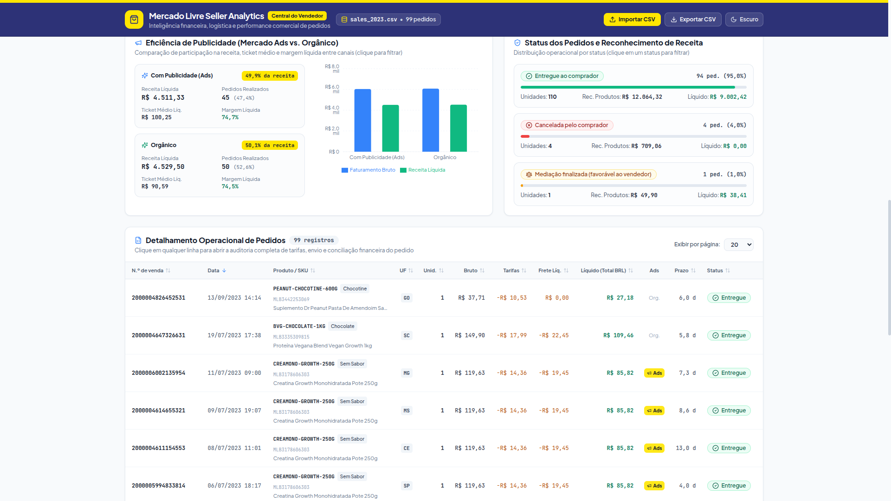
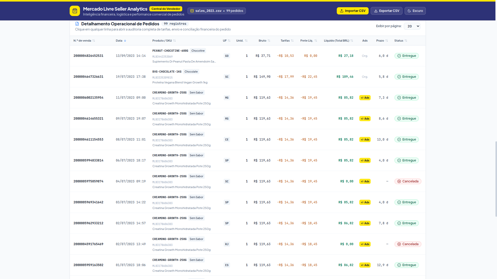

# Mercado Livre Seller Analytics — Painel de Performance de Vendas

Painel analítico full-stack para performance comercial no Mercado Livre: ingestão e higienização de CSVs de vendas, KPIs executivos, evolução temporal, conciliação financeira (Bruto → Líquido), ranking por SKU/anúncio, desempenho por UF, eficiência de Ads e tabela operacional de pedidos — tudo em `pt-BR` (`R$ 1.234,56`, `DD/MM/YYYY`).



## Sumário

- [Features](#features)
- [Demo](#demo)
- [Stack e Arquitetura](#stack-e-arquitetura)
- [Pré-requisitos](#pré-requisitos)
- [Instalação e Quickstart](#instalação-e-quickstart)
- [Uso](#uso)
- [Configuração](#configuração)
- [API](#api)
- [Testes e Qualidade](#testes-e-qualidade)
- [Estrutura do Projeto](#estrutura-do-projeto)
- [Dados e Regras de Negócio](#dados-e-regras-de-negócio)
- [Troubleshooting](#troubleshooting)
- [Roadmap](#roadmap)
- [Licença](#licença)

## Features

- **5 KPIs executivos:** Receita Líquida, Faturamento Bruto + ticket médio, Pedidos Realizados/Unidades + cancelamento, Tarifas ML + frete líquido, Prazo médio de entrega (exclui cancelados).
- **Filtros globais:** período, UF, SKU/sabor, `# de anúncio` MLB, status, Ads vs. orgânico, busca textual (`N.º de venda`, cliente, SKU, título).
- **Gráficos interativos (Recharts):** evolução mensal/semanal/diária, decomposição financeira conciliada ao centavo, ranking por SKU e por anúncio, UF x receita/prazo/frete, Ads vs. orgânico, distribuição por status.
- **Tabela operacional:** ordenação, paginação (10/20/50/100), badges semânticos de status, modal de auditoria do pedido e exportação CSV.
- **Upload de CSV:** `POST /api/upload` valida e carrega novo dataset em memória; `POST /api/reset` restaura `data/sales_2023.csv`.
- **Dark mode**, formatação `pt-BR` e design system inspirado no Mercado Livre (`#FFE600` / `#2D3277` / `#3483FA`).

## Demo

| Topo: filtros + KPIs | Evolução + Financeiro |
|---|---|
|  |  |

| Ranking + Regiões | Ads + Status |
|---|---|
|  |  |

| Tabela de pedidos |
|---|
|  |

> Dataset padrão: `data/sales_2023.csv` — 99 pedidos (94 Entregue, 4 Cancelada, 1 Mediação ganha), Jan–Set/2023.

Para rodar localmente veja [Instalação e Quickstart](#instalação-e-quickstart): backend em `http://127.0.0.1:8000` e frontend em `http://127.0.0.1:5173`.

## Stack e Arquitetura

**Backend:** Python 3.12, FastAPI, Pandas, Pydantic, Uvicorn — ingestão, limpeza, cálculo de KPIs e REST.

**Frontend:** React 18 + Vite + TypeScript, Tailwind CSS, Recharts, Lucide React — filtros, KPIs, gráficos e tabela.

```
CSV Mercado Livre → data_loader.py (limpeza) → analytics.py (KPIs/agregações)
        → main.py (FastAPI /api/*) → React (fetchDashboard/fetchOrders) → Recharts + tabela
```

## Pré-requisitos

- **Via Docker (recomendado):** Docker e Docker Compose
- **Execução local:** Python 3.12 + `.venv` local, Node.js 18+ e npm
- CSV no padrão Mercado Livre (UTF-8, 28 colunas) — ex.: `data/sales_2023.csv`

## Instalação e Quickstart

### Com Docker Compose

```bash
# Subir backend (FastAPI :8000) + frontend (Nginx :5173)
docker compose up --build
```

- **Dashboard:** `http://localhost:5173`
- **API / Swagger:** `http://localhost:8000/docs`
- **Parar os containers:** `docker compose down`

### Execução Local (sem Docker)

```bash
# 1. Backend — dependências de produção
.venv/bin/pip install -r requirements.txt

# Dev (testes, lint, TestClient)
.venv/bin/pip install -r requirements_dev.txt

# 2. Frontend
cd frontend && npm install

# 3. Subir backend (terminal 1, raiz do projeto)
.venv/bin/uvicorn backend.app.main:app --host 127.0.0.1 --port 8000
# → http://127.0.0.1:8000/api/health

# 4. Subir frontend (terminal 2)
cd frontend && npm run dev
# → http://127.0.0.1:5173 (proxy /api → 127.0.0.1:8000)
```

Build de produção do frontend:

```bash
cd frontend && npm run build && npm run preview
```

## Uso

- **Filtros globais no topo:** período, UF, SKU, anúncio MLB, status, Ads/orgânico, busca. `Limpar Filtros` restaura o dataset completo.
- **Granularidade temporal:** Mensal / Semanal / Diário no gráfico de evolução.
- **Clique para filtrar:** ranking (SKU/anúncio), tabela UF, cards Ads e cards de status aplicam filtro global.
- **Tabela:** clique na linha para auditoria (tarifas, frete, conciliação); seletor de page-size e `Exportar CSV` no header exporta o filtro atual.
- **Importar CSV:** botão `Importar CSV` no header (`POST /api/upload`); para voltar ao padrão use `POST /api/reset`.

## Configuração

| Variável | Obrigatória | Default | Descrição |
|---|---|---|---|
| `CORS_ALLOWED_ORIGINS` | Não | `http://localhost:5173,http://127.0.0.1:5173,http://localhost:4173,http://127.0.0.1:4173` | Lista separada por vírgula de origens liberadas no CORS (backend) |
| `VITE_API_BASE_URL` | Não | `""` (usa `/api` relativo via proxy do Vite) | Base da API no frontend; defina a URL do backend em deploy separado (ex.: `http://127.0.0.1:8000`) |

Exemplo:

```bash
CORS_ALLOWED_ORIGINS="https://app.exemplo.com.br" \
  .venv/bin/uvicorn backend.app.main:app --host 0.0.0.0 --port 8000
```

Limites de upload: apenas `.csv`, tamanho máximo `MAX_CSV_SIZE_BYTES` (ver `backend/app/data_loader.py`); CSV vazio ou fora do schema retorna `400` com mensagem.

## API

Base: `http://127.0.0.1:8000` — docs interativas em `/docs` (Swagger) e `/redoc`.

| Método | Endpoint | Descrição |
|---|---|---|
| `GET` | `/api/health` | Status + `dataset_rows` + `active_source` |
| `GET` | `/api/filters` | UFs, SKUs, anúncios, status, `min_date`/`max_date` |
| `GET` | `/api/dashboard` | KPIs + séries + breakdown financeiro + rankings + UF + Ads + status |
| `GET` | `/api/orders` | Pedidos paginados/ordenados/filtrados |
| `POST` | `/api/upload` | Upload de CSV (`multipart`, campo `file`) |
| `POST` | `/api/reset` / `/api/reset-dataset` | Restaura `data/sales_2023.csv` |

Filtros `GET` (query, todos opcionais): `start_date`, `end_date` (`YYYY-MM-DD`), `state` (nome ou UF), `sku`, `listing_id`, `status`, `ad_sale` (`true`/`false`/`all`), `search`, `granularity` (`month`/`week`/`day`). `GET /api/orders` adiciona `page`, `page_size` (1–200), `sort_by`, `sort_dir` (`asc`/`desc`).

```bash
curl -s http://127.0.0.1:8000/api/health
curl -s "http://127.0.0.1:8000/api/dashboard?granularity=month&state=SP" | head -c 500
```

## Testes e Qualidade

Ordem oficial de verificação (`AGENTS.md`):

```bash
.venv/bin/ruff check .
.venv/bin/ruff format --check .
.venv/bin/pytest
```

| Comando | O que cobre |
|---|---|
| `.venv/bin/pytest` | 21 testes: `test_data_loader`, `test_analytics`, `test_api` |
| `.venv/bin/pytest backend/tests/test_api.py -k "test_dashboard"` | Subconjunto por nome |
| `cd frontend && npm run typecheck` / `npm run build` | Tipos + build Vite |
| `cd frontend && npm test` | Vitest |

## Estrutura do Projeto

```
.
├── backend/
│   ├── app/
│   │   ├── main.py         # FastAPI, CORS, /api/*
│   │   ├── data_loader.py  # ingestão/limpeza + dataset_store
│   │   ├── analytics.py    # KPIs, séries, rankings, UF, Ads
│   │   └── schemas.py      # Pydantic (Health, Filters, Dashboard, Orders)
│   ├── tests/              # test_data_loader/ analytics/ api
│   └── Dockerfile          # container Python 3.12 + Uvicorn
├── frontend/
│   ├── src/
│   │   ├── api/client.ts   # cliente tipado da API
│   │   ├── components/     # Header, GlobalFilterBar, KpiSection, charts/, OrdersTable, OrderDetailModal
│   │   ├── hooks/          # useDebouncedValue, useTheme
│   │   ├── types/          # DashboardFilterState, DashboardResponse...
│   │   └── utils/          # formatCurrencyBRL, formatDateBR, formatPercentBR, exportOrdersToCsv
│   ├── Dockerfile          # multi-stage (Node build → Nginx)
│   ├── nginx.conf          # SPA fallback + proxy reverso /api → backend:8000
│   └── vite.config.ts      # proxy /api → 127.0.0.1:8000 (dev)
├── data/
│   └── sales_2023.csv      # dataset padrão (99 linhas, UTF-8)
├── docs/screenshots/       # screenshots do README
├── docker-compose.yml      # orquestração backend (:8000) + frontend (:5173)
├── .dockerignore           # exclusões de contexto Docker
├── requirements.txt        # prod: fastapi, uvicorn, pandas, pydantic, python-multipart
├── requirements_dev.txt    # dev: -r requirements.txt + pytest, httpx, ruff
├── pyproject.toml          # pytest + ruff config
├── .gitignore              # venv, node_modules, dist, env, logs
└── README.md
```

## Dados e Regras de Negócio

Fonte: `data/sales_2023.csv` (99 pedidos). A ingestão (`data_loader.py`) trata 5 anomalias verificadas — não some colunas brutas sem normalizar:

1. **Sinal invertido nas tarifas (linhas 97–98):** pedidos `2000005066734540` e `2000005066738224` trazem `Tarifa de venda e impostos` e `Tarifas de envio` positivos, embora o `Total (BRL)` já os desconte. Regra: deduções com `-abs(v)`, magnitudes com `abs(v)`.
2. **Cancelados distorcem lead time:** `Cancelada pelo comprador` (4) repete `Data da venda` em envio/entrega (delta 0). Regra: excluir cancelados de `avg_delivery/dispatch/transit_days`.
3. **3 status e reconhecimento de receita:** `Entregue` (94) + `Mediação finalizada. Te demos o dinheiro` (1, pedido `2000004505924241`, `Total 38,41`) = realizadas (95, Receita Líquida); `Cancelada` (4) tem `Total 0,0` com estorno em `Cancelamentos e reembolsos`.
4. **Encodings:** `Sim`/`Não` → bool; `Reclamação encerrada` `0.0`/`1.0` → bool; `Unidades` via `int(float(v))`; `N.º de venda` como `str` (16 dígitos).
5. **Anúncio vs. SKU:** múltiplos SKUs por `# de anúncio` (ex. `MLB2787409678`, `MLB3179617242`); derive sabor do `SKU`, não de `Variação` (ex. `PEANUT-CHOCOTINE-600G` veio como `Sem Sabor`).

## Troubleshooting

| Sintoma | Causa provável | Ação |
|---|---|---|
| Frontend vazio / `Failed to fetch` | Backend fora do ar ou proxy errado | Suba `uvicorn ... :8000` e confira `GET /api/health`; `vite.config.ts` aponta `/api → 127.0.0.1:8000` |
| `Invalid 'ad_sale' query parameter` (400) | Valor fora de `true/false/all` | Use `ad_sale=all`, `true` ou `false` |
| `start_date cannot be later than end_date` (400) | Período invertido | Inverta as datas ou limpe filtros |
| Upload rejeitado (400) | Extensão ≠ `.csv`, arquivo vazio, acima do limite ou schema inválido | Confira mensagem do `detail` e reexporte o CSV no padrão ML |
| KPIs zerados após filtro | Combinação sem pedidos | `Limpar Filtros` ou amplie o período |
| Erro de CORS em deploy | Origem não liberada | Defina `CORS_ALLOWED_ORIGINS` com o domínio do frontend |

## Roadmap

- [ ] Paginação virtualizada e exportação XLSX da tabela
- [ ] Cache server-side por combinação de filtros
- [ ] Testes E2E (Playwright) dos filtros críticos
- [ ] CI (ruff + pytest + build) no PR

## Licença

Projeto interno de portfólio/estudo — sem licença pública definida. Dataset `data/sales_2023.csv` usado apenas para fins analíticos/demonstração.
